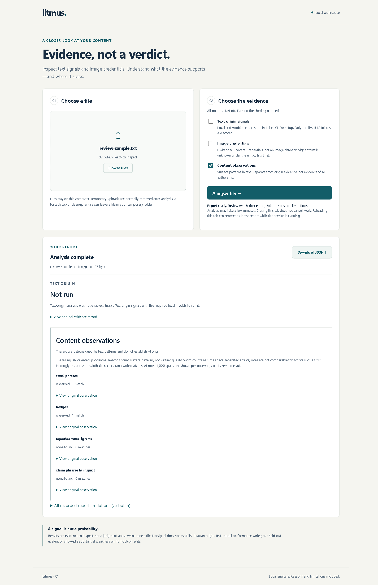
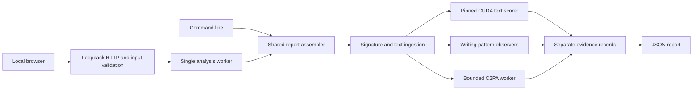

# Litmus

> **Release security status:** The 2026-11-02 advisory audit found unresolved
> dependency matches. This public repository is a local review candidate, not a
> security-cleared stable release. See [release readiness](docs/RELEASE-READINESS.md)
> and the [public visibility audit](docs/PUBLIC-VISIBILITY-AUDIT.md).

[Portfolio and demo narrative](docs/PORTFOLIO.md) · [Draft release notes](docs/RELEASE-NOTES-R1.md)

[Release milestone](https://github.com/RyanJBush/AI-Generated-Content-Detection-and-Authenticity-Analyzer/milestone/1) · [Contributing](CONTRIBUTING.md) · [Security status](SECURITY.md)

**A local evidence workbench for text-origin signals, writing patterns, and image
Content Credentials.** Upload a file, choose checks, inspect their reasons and
limitations, and export the original structured report. Litmus does not assign
an "AI percentage" or establish who authored a file.

The engineering focus is traceability: exact-configuration calibration, grouped
held-out evaluation, explicit failure accounting, bounded native work, and
separation of provenance evidence from writing-pattern observations.

On the frozen held-out RAID subset, clean-text AUROC was **0.80358**, with
**66.37% TPR / 4.59% FPR** at the development-selected threshold. Homoglyph edits
reduced detection to **8.59%**. These sample-specific results are not general
accuracy claims; intervals, coverage and limitations appear below.

[Install and run](INSTALL.md) · [Scientific results](#held-out-evaluation-r1-g-scientific-results-independently-reviewed)
· [Architecture](#architecture-and-trade-offs) · [Readiness audit](docs/plans/RECRUITER-READINESS.md)



*Actual local interface, constructed sample text, content observations enabled.
Text-origin analysis is off in this screenshot; no model-performance claim.*

> **Status: R1 complete for local use.** The local interface, text signals,
> content observations, image credentials and held-out scientific evaluation are
> implemented and reviewed. Historical G recovery did not meet its original
> integrity requirement and is retired from supported use; the completed
> uninterrupted evaluation remains valid and has a strict read-only verifier.
> Frozen sources, calibration and scientific evidence are unchanged. Original E
> transfer-cap compliance remains unproven. Later modalities/releases remain planned.
> The retired text-only implementation is preserved in Git history at
> `litmus-text-before-multimodal-2026-10-26` (`106a645`).

Litmus reports evidence about text and image provenance. Audio, video and
document analysis remain planned.

## Open Litmus

For a new computer or fresh checkout, follow [INSTALL.md](INSTALL.md) first.

Double-click **Start-Litmus.cmd**, then open **http://127.0.0.1:8765** in your
browser. Or run this from the project folder:

```powershell
.venv\Scripts\python.exe -m litmus.local_ui
```

Choose a file, turn on the checks you need, and select **Analyze file**. Review
the reasons and limitations, then **Download JSON** to keep the full report.
All checks start off, preserving existing analysis defaults. Text origin uses
the pinned local CUDA setup; content observations need no model weights. Image
credentials inspect embedded provenance and do not detect generated images.

The server binds only to `127.0.0.1`; there are no remote assets or cloud calls.
Only one analysis runs at a time. Files use a server-owned temporary path and
are removed on normal completion or handled failure; reports stay in memory
unless downloaded. A hard process termination can leave a temporary file.
Closing a tab does not cancel native work. Keep it open for the report;
Ctrl+C stops the server and waits for active analysis. If the port is occupied,
use `--port 8767`. Do not expose this single-user service through a public proxy.

The existing CLI remains available, with unchanged defaults:

```powershell
.venv\Scripts\python.exe -m litmus.cli analyze sample.txt --text-origin binoculars --quality on -o report.json
.venv\Scripts\python.exe scripts/verify_r1_release.py --metrics
```

The second command verifies completed evaluation from saved metadata, scores and
draws only. It is repeatable, changes no receipts and never opens held-out texts
or runs a model. Legacy `evaluate_r1g.py` scoring, recovery and receipt-creation
commands remain historical provenance and are **unsupported**. No further
held-out scoring is authorized.

Use the checkout launcher for the calibrated local profile. The fresh wheel
passed model-free UI/CLI checks with existing pinned dependencies; it is not a
portable bundle of the weights, calibration or execution profile.

## Architecture and trade-offs



- **Python 3.13, standard-library HTTP, plain HTML/CSS/JavaScript.** The local
  interface adds no framework or database dependency. It is single-user, not a
  production internet-facing service.
- **One report owner.** UI and CLI call the same assembler and analyzers; the UI
  explains results without altering the exported scientific record.
- **Bounded work.** One UI job at a time; bounded file size and total upload
  deadline. Native C2PA work has a response deadline but is not cancelled by it.
- **Explicit recovery.** The tab remembers only its last job ID and option
  choices, so reload/status retry can recover the in-memory job. Files and
  reports are not persisted in browser storage. Restarting the service or
  replacing its latest job makes an old job unavailable.
- **Frozen science.** Exact source, tokenizer, model, library and execution
  identities bind calibration. This favors reproducibility over hardware
  portability. Original E/F/G artifacts remain immutable; the supported verifier
  reassembles saved evidence without rescoring texts.

The Binoculars-inspired ratio uses shifted performer negative log likelihood
over observer-to-performer cross-entropy at all positions, including the final
position. This project-specific formula is explicit, tested against an oracle,
and included in the configuration identity; published performance from other
implementations is not imported as Litmus performance.

## Development checks and contribution record

From the installed checkout with the existing pinned development dependencies:

```powershell
.venv\Scripts\python.exe -m pytest -q
.venv\Scripts\python.exe -m ruff check .
.venv\Scripts\python.exe -m pip check
.venv\Scripts\python.exe scripts\verify_wheel_r1.py
.venv\Scripts\python.exe scripts\verify_r1_release.py --metrics
```

The default tests exclude the `slow` model-dependent marker. Some default tests
use temporary loopback listeners/native C2PA; run them where these are supported.
The wheel check uses existing dependencies without downloading packages. The
scientific verifier needs full Git history, but no dataset text or model weights.
There is no configured static type-checker gate. Browser scenarios are retained
in `scripts/browser_readiness_checks.js` and `scripts/browser_recovery_checks.js`
for the existing Playwright tool;
Playwright is not an application dependency. No hosted demo is deployed.

The latest readiness run passed **883 default tests, with 21 slow tests excluded**,
both inside and outside the checkout. See the [verification record](eval/results/readiness/VERIFICATION.md)
for exact results, browser coverage, Claude review and untested limitations.
Older milestone counts below describe their original revisions.

Exports deliberately retain `litmus-report/r0` and historical limitation strings
for compatibility and scientific identity. The current UI explains disabled
checks as "Not run" while preserving the original records verbatim.

Ryan owns project scope, approvals and the recorded engineering decisions.
Implementation and reviews used Codex and Claude Code assistance; Copilot
performed the dependency advisory triage, as disclosed
in the decision log and review artifacts. This repository does not claim that
all code was hand-written, that model reviews constitute independent human
validation, or that a production user base exists. For an interview, the useful
discussion is the actual trade-offs, failure cases and reproducible evidence.

## What Litmus will and will not do

Litmus reports **evidence**, not verdicts.

- **Origin evidence and content-quality observations are separate record types.** Origin evidence concerns *how content was produced* (a validated Content Credentials manifest, a calibrated detector result). Quality observations describe *what the content contains* (repeated phrases, hedges). Quality observations never affect origin results.
- **Inconclusive is a valid result,** always with a reason.
- **No uncalibrated score is presented as a probability.** Raw scores are labeled as scores. Flags appear only where the exact configuration has been calibrated on held-out development data.
- **Claims are limited to evaluated tasks.** Each modality has its own methods, evaluation, and limitations. There is no combined "AI percentage."
- **Segment records.** Current text and image inputs produce one root segment.
  Mixed-document extraction is planned for a later release.
- **Absence is not evidence.** No Content Credentials, no metadata, or a low detector score does not mean human-made.
- **Local and offline settings.** Models load from local files. Python network
  and subprocess guards are active; C2PA uses native offline settings. Remote
  Content Credentials are not fetched. Paired loopback tests observed zero
  connections for the exercised remote fixtures/settings. Network isolation
  has not been demonstrated; Python guards do not intercept native networking.
- **Not for punitive decisions.** Detection methods have known false-positive and evasion problems. Do not use Litmus as the sole basis for academic, employment, legal, or moderation decisions.

## Text quality observations: limitations

Opt-in with `litmus analyze FILE --quality on` (default `off`).

- **No AI-origin claim.** Quality observations count surface patterns (stock phrases, hedges, repeated word 3-grams, claim phrases to inspect). They do not establish AI origin and never affect origin results.
- **English-oriented, provisional lexicons (v1).** The lexicons were drafted with AI assistance and reviewed by Ryan; their entries and counts are not evaluated against any corpus.
- **Word counts assume space-separated scripts.** Text without spaces (for example CJK) counts each run as one word, so rates are not comparable across scripts.
- **Lexicon licensing: MIT**, approved by Ryan on 2026-11-02. Frozen v1
  headers retain their historical pending notice to preserve evaluated hashes;
  the current license decision below supersedes that notice.

## Image provenance: opt-in and limitations

`litmus analyze IMAGE --c2pa on` enables C2PA evidence for accepted JPEG, PNG
and WebP images. The default is `--c2pa off`; omitted and explicit off retain
the existing image placeholder reports. Text-only inputs are unchanged.

Integrity, claim signature, signer trust, timestamp state and AI-use declaration
are reported separately for the active manifest and its referenced ingredients.
Unsigned EXIF fields and XMP presence/length are labeled **unverifiable; editable;
not evidence** and never affect origin results. EXIF DateTime is not verified
signing time.

**With an empty production trust list, signer_trust is unknown for every
manifest, so no C2PA result can be supports_ai in R1 under the production
policy.** A valid AI-use declaration alone yields inconclusive /
untrusted_signed_ai_declaration. Absence of credentials or declarations is not
evidence of human origin. R1 examines provenance, not AI-generated image content.

Project timestamp cases are **constructed**, not evidence of real TSA validation.
The reviewer supplied the [C2PA 2.5 section 14.8 citation](https://spec.c2pa.org/specifications/specifications/2.5/specs/C2PA_Specification.html#_validate_the_time_stamp);
the builder did not independently fetch or verify its text.

The 120-second C2PA deadline limits response waiting, not native execution.
A timed-out read continues on one worker; further requests return a busy error
until it finishes. A produced report exits 0 even if its analyzer record says
error. Missing activation evidence, invalid production trust resources, missing
SDK or versions differing from reviewed 0.38.0 / 0.91.0 prevent activation:
the CLI prints an error and exits 1 without writing a report.

See [interfaces](docs/interfaces.md) and [decisions](docs/decisions.md) for the
record contract, observed tests and remaining limits.

## Release roadmap (later work remains proposed)

| Release | Scope | Effort (estimate) |
|---|---|---|
| R0 | Foundations: record schemas, segment ancestry/coordinates, ingestion limits, report format, test harness | 8–14 h |
| R1 | Text origin evidence (provisional zero-shot method, evaluated) + text quality observations + **image provenance** (Content Credentials: integrity, signature, signer trust, and declared AI use reported separately; a declaration from an untrusted signer is shown but not treated as evidence) | 25–40 h |
| R2 | **Image detection** (provisional method, evaluated) + PDF/DOCX documents | 30–50 h |
| R3 | Synthetic-speech audio detection, evaluated in-domain (out-of-domain set blocked pending license clarification) | 25–40 h |
| R4 | Video, limited to evaluated face-manipulation detection, plus the audio track via R3 | 40–70 h |
| | **Total (estimate)** | **128–214 h** |

**R1 checks image provenance only; it does not detect AI-generated images.**
With C2PA enabled, an image without Content Credentials gets an inconclusive
result. With it off, the existing not-supported placeholder remains.

R0 and R1 are specified in detail; R2–R4 are provisional outlines. Model choices are **provisional** until license, access, feasibility, and training-data-overlap checks pass. Several candidate datasets are licensed for non-commercial use only. See `SPEC.md`.

## Current status

- Implementation: R0 foundations and R1 text/quality work are implemented;
  C2PA D1–D3 and R1-D are independently reviewed and closed. R1-E data preparation
  is independently reviewed and closed with 973 retained source groups (298 dev,
  675 test). R1-F scored 1,484 development rows successfully, including 298 valid
  human negatives. The calibration/freeze are independently reviewed and closed;
  approved R1-G evaluated all 3,361 held-out rows successfully and its scientific
  results were independently reconstructed. R1-H and final checks are complete.
  Historical G recovery is unmet/retired, not retroactively fixed.
  Ryan accepted the specific historical redirect-body accounting uncertainty;
  this is not proof that the original cumulative transfer met its 13 GB cap.
  The downloader correction was tested offline, with no further network requests.
  No scoring, calibration or test evaluation was performed in R1-E.
- Results: model-free tests, fixture observations and scorer
  benchmarks are recorded in `docs/decisions.md` and `eval/results/`.
  Exact-profile text calibration/evaluation is supplied; no image detector.
- Open decisions: `SPEC.md` §15.
- Governing corrections: `R1-PLAN-CORRECTIONS-A.md`, `R1-PLAN.md`, the SPEC
  addenda and `docs/plans/R1-D-PLAN.md`, including its approved corrections.

## Development calibration (R1-F, independently reviewed)

The local CUDA/fp32 profile has a 5% empirical development calibration, bound to
the exact configuration hash in [the freeze](eval/freezes/r1f_freeze.json).
The scorer uses r=-raw_score and flags only r > -0.9272342324256897, equivalently
raw_score < 0.9272342324256897. Equality is not flagged. There were 14 exceedances
among 298 development-human negatives and one threshold tie; these are development
observations, not test FPR or a population guarantee. All 1,484 dev scores were
valid; the independent first-ten-human fresh-process audit matched exactly.

Configuration hash:
`10f0fa316fa5f3d87c7819f86f09ecedc5bc5b1b71e9250d8586aece7390db2f`.
Source implementation: `047421cf4c36f8a946453eacc1b9c056bf5147d6`.
CUDA preflights and development work reported zero Python connection/forbidden
data-access attempts. This does not demonstrate OS/native network isolation.
CPU is uncalibrated, 1% calibration stays disabled, and raw scores are not
probabilities. Updating source, driver, libraries or any hashed profile field
invalidates matching. Default CLI analysis remains a placeholder unless explicitly
enabled; default image reports and quality/origin separation are unchanged.

See [F verification](eval/results/r1f_verification.json) and
[the approved plan](docs/plans/R1-F-PLAN.md). Ryan supplied independent confirmation
of freeze commit `bf455659053cca15ec82cb85065613c6b7459a44`. Ryan subsequently
approved [R1-G](docs/plans/R1-G-PLAN.md) at `8afab9e` for G0–G5 execution.

## Held-out evaluation (R1-G, scientific results independently reviewed)

Evaluation implementation/policy commit:
`b5cdc56d14a063d56683d825cef7c7ecdaac69b4`, committed before test access.
The accepted F freeze, calibration, source/configuration and E data/reconciliation
identities passed, including a fresh exact-profile CUDA/synthetic preflight.
The threshold and configuration above were unchanged. All **3,361 requested rows
in 675 source groups** were valid: 675 humans, 675 clean machines and 2,011 attacks.
There were 3,361 attempts and reads, no failures, pending IDs, retries or recovery.

| Primary clean statistic | Observed value | Grouped 95% interval |
|---|---:|---:|
| AUROC (higher r=-raw is more machine; exact ties count 0.5) | 0.80358 | 0.77626–0.82907 |
| TPR | 448/675 = 66.37% | 62.37–69.93% |
| **Actual test FPR** | **31/675 = 4.59%** | **3.26–6.07%** |

The development 14/298 and test 31/675 are separate observations. The 5% label
does not guarantee test or population FPR; the test interval extends above 5%.
Scores are not probabilities, and an unflagged result does not establish human origin.

Paired rates use the **same valid parent/attack pairs** in each row; delta is
attack minus clean in percentage points. Intervals use the same shared draws.

| Attack | Valid pairs | Clean rate [95% interval] | Attack rate [95% interval] | Delta pp [95% interval] |
|---|---:|---:|---:|---:|
| homoglyph | 675/675 | 66.37% [62.37, 69.93] | 8.59% [6.52, 10.67] | -57.78 [-61.48, -54.07] |
| paraphrase | 661/675 | 66.11% [62.16, 69.73] | 78.06% [74.70, 81.18] | +11.95 [8.40, 15.38] |
| zero_width_space | 675/675 | 66.37% [62.37, 69.93] | 92.44% [90.22, 94.37] | +26.07 [22.07, 29.93] |

Homoglyph detection was substantially lower in this sample. The other two
attack labels increased detection here; this does not establish general attack
robustness. Four paired outcome counts, all coverage and all exploratory slices
are in [the full metrics](eval/results/r1g/metrics.json). Fourteen paraphrases were
already unavailable in E; none were refilled. One paraphrase scored-window no-op
was retained; there were no raw-text no-ops in these attack pairs.

Uncertainty uses 1,000 joint source-group bootstrap draws, seed20261030, fixed
domain-separated encoding, multiplicity retained and nearest-rank percentiles.
Every overall statistic had 1,000 defined/0 undefined replicates. The predeclared
112 clean and 60 paired slices are all published: 88 clean domain/generator cells
and one paired slice have counts/points only, labeled insufficient data, with no
interval. These are descriptive, correlated comparisons, not rankings or multiple
hypothesis tests. Independent expanded average-rank/rate reassembly reproduced all
saved results and intervals without opening test blobs or rescoring.

This is Litmus's held-out **source-group subset of RAID train.csv**, not the
publisher's official test.csv or an unseen-generator protocol. The same generator
families can occur in development and test. Results are conditional on this
prepared sample, score eligibility/validity, frozen calibration and exact local
profile. Calibration uncertainty is excluded from the intervals. Pretraining
overlap remains unquantified; language eligibility is a proxy, not verified
language coverage. Only the first 512 tokens are scored. There is no broad AI
detection accuracy, calibrated probability or population-validity claim.

The scoring operation took **5,303.19s (88.4min)** wall and 4,966.84 CPU seconds,
exceeding the 15–30min estimate. The slowdown's cause was not profiled; gates were
not relaxed. Peak GPU allocated/reserved bytes were 5,854,253,568 / 6,188,695,552.
Metadata artifacts are below 100MB; no raw texts, token arrays or weights are
redistributed. Python guards recorded zero blocked operations; OS/native network
isolation is not established. Original E transfer-cap compliance remains unproven.
See [verification](eval/results/r1g_verification.json),
[counts](eval/results/r1g/counts.json) and [independent formula reassembly](eval/results/r1g/reassembly.json).
The committed `verify-results` command creates a timing-bearing immutable receipt;
repeating it in the same directory would reject new timing bytes. A separate
[fresh read-only reassembly](eval/results/r1g_readonly_reassembly_check.json) passed
without changing any original scientific file. See interfaces for repeat verification.
Independent review on 2026-11-02 reproduced all metrics/intervals, original hashes,
actual pairwise AUROC and flag counts. It also found a legacy resume defect:
intent/access identities were checked too late on that unused path. The actual
run had no recovery and passes strict verification. That historical requirement
is **unmet and retired**, not claimed to have passed. The supported verifier
checks every event before downstream verification, binds original Git blobs,
is deterministic and makes no writes. Corruption regressions and independent
repeated reconstruction passed. The completed scientific evaluation is closed
with this explicit disposition, not unqualified historical G0–G5 compliance.

## R1 verification and limits

Final selected model-free suite: **632 passed, 21 slow tests excluded**, inside
and outside the repository. Ruff, pip check, whitespace, loopback contract tests,
independent code review, fresh wheel checks, desktop/mobile walkthrough, keyboard
controls, error/busy recovery, safe filename display, JSON export and frozen-byte
verification passed. See [evidence](eval/results/r1h/verification.json),
[reviews](eval/results/r1h/reviews.json) and [UI](eval/results/r1h/production-initial.png).

No further CUDA scoring, held-out text access, calibration, acquisition, external
network requests or dependencies were used for this completion. Full slow/native
C2PA suites, live GPU UI scoring, hardware portability, a full accessibility/
screen-reader audit and OS/native isolation were not rerun or established here.
Scientific limits and the historical transfer exception remain. R1 is a local
tool; R2–R4 image/audio/video/document detectors remain future work.

## Publication verification

Publication preparation on 2026-11-02 additionally verified two consecutive
synthetic CUDA submissions and one constructed C2PA fixture through the real
local HTTP interface. The CUDA reports were identical and matched the accepted
preflight and calibration; C2PA retained unknown production signer trust.
This closes the engine-integration gap for the exercised non-flagged text path
and constructed C2PA case; flagged text results were not exercised over HTTP.
No held-out texts were rescored. Fresh-source wheel installation also passed
with locally available dependencies; new-machine dependency downloads and
alternate GPU profiles remain unverified. See `eval/results/publication/`.

Earlier builder-dispatched reviews were fresh-context Codex subagent reviews,
adjudicated by the primary agent. Claude's separate read-only review is advisory;
neither form of review substitutes for the recorded executable checks.

## License

Litmus's original code, documentation and project-authored quality lexicons are
licensed under the [MIT License](LICENSE), approved by Ryan on 2026-11-02.
The copyright-holder name uses the existing Git author identity, RyanJBush.
This decision supersedes historical project-license and lexicon-license
pending notices, including those retained in the frozen v1 lexicon headers.
Those files and the scientific evidence remain byte-for-byte unchanged.

Third-party dependencies, datasets and model weights retain their own terms
(`SPEC.md` §17); this license does not relicense those materials or authorize
redistribution of the locally held dataset or model weights.
